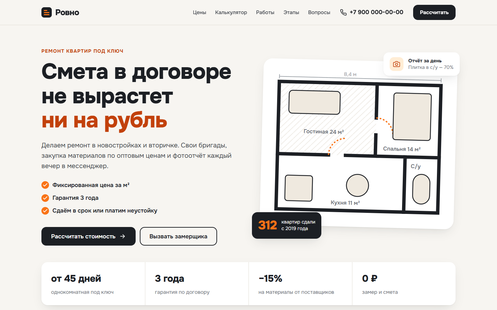

# Ровно: лендинг ремонта квартир

Демо-концепт продающего лендинга для компании по ремонту квартир под ключ.

**[Открыть демо](https://grozeser.github.io/remont-landing/)**



## Что внутри

- Калькулятор сметы: тариф, тип жилья, площадь и доп. работы. Цена и срок пересчитываются сразу, расчёт подставляется в заявку
- Тарифы с ценой за м², кнопки «Рассчитать» выбирают тариф в калькуляторе
- Примеры работ, этапы ремонта, преимущества и частые вопросы
- Форма заявки с проверкой имени, телефона и согласия на обработку данных
- Адаптив под телефон: меню-бургер, крупные кнопки, без горизонтальной прокрутки

## Стек

HTML, CSS, JavaScript без фреймворков и сборки. Шрифт Onest, иконки и иллюстрации нарисованы в SVG.

## Запуск

Откройте `index.html` в браузере или запустите любой статический сервер:

```bash
python -m http.server 8000
```

Компания, цены и контакты вымышленные. Форма ничего не отправляет.
